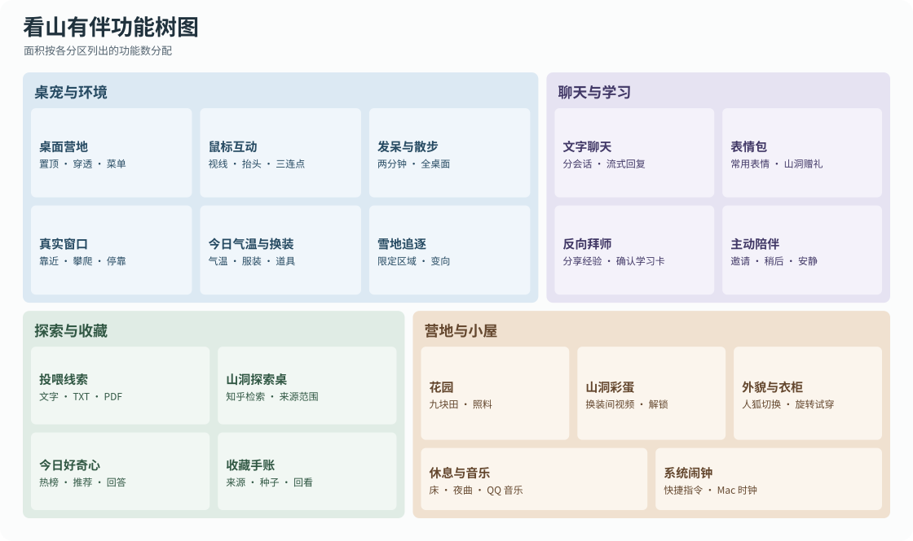

# 看山有伴 · 功能与协作指南

看山有伴是面向 Apple 芯片 Mac 的刘看山桌宠。桌面上的刘看山可以活动、感知天气和回应用户，也可以从营地进入聊天、知乎探索、种植和暖木小屋。

## 功能分区



树图面积按各区列出的功能数分配。下面的文件定位表可直接跳转到代码。

## 首次启动

需要 **Apple 芯片 Mac、Node.js 24** 和 Xcode Command Line Tools。先在仓库根目录运行：

```sh
xcode-select -p
npm ci
# 若 npm 没有执行 Electron 的安装脚本，补装锁定版本的运行时
test -d node_modules/electron/dist/Electron.app || node node_modules/electron/install.js
npm run package:mac
open release/看山有伴.app
```

若第一条命令提示缺少工具，运行 `xcode-select --install`，安装完成后再构建。应用使用本地 ad-hoc 签名。如果 clang 因 SDK 的 `.tbd` 格式报错，请更新 Command Line Tools，或设置 `KANSHAN_MAC_SDK` 指向一套与本机链接器匹配的 SDK 后重新打包。再次打包可指定新输出目录，例如 `KANSHAN_PACKAGE_DIR="$(mktemp -d)" npm run package:mac`。开发时可用 `npm run desktop` 启动 Electron，或用 `npm run dev` 单看前端布局。原生菜单、窗口攀爬、文件投喂和系统闹钟请在 Electron 中使用。

### 配置在线服务与测试档案

1. 先试桌宠、山洞、衣柜、花园和投喂的「本地演示」。这些流程可以在未填写模型密钥时使用。右上角的气温使用 Open-Meteo，需要网络。
2. 使用打包应用时，从仓库运行 `./Configure-Model.command`，打开应用数据目录中的 `model.env`。直接开发时可把 [`.env.example`](.env.example) 复制为项目根目录的 `.env`。
3. 用自己的 `ZHIHU_ACCESS_SECRET` 配置知乎直答与开放平台能力。回到「模型与检索设置」，先点「重新检查配置」，再按界面确认连接测试或额度查询。线上权限和配额依账户而异。模型和检索配置分别校验。
4. 聊天也支持已有的本地 Ollama 或 llama.cpp 服务。按模板设置 `CHAT_PROVIDER`、`CHAT_MODEL`、`CHAT_BASE_URL`。使用 [Qwen 启动脚本](Launch-Kanshan-Qwen.command) 时，用 `KANSHAN_LLAMA_SERVER` 和 `KANSHAN_CHAT_MODEL_FILE` 指定自己的运行器和 GGUF。可选模型权重和本地服务自行准备。
5. 打包版默认使用 `~/Library/Application Support/看山有伴-林间预览`。调试或演示可先设 `KANSHAN_DATA_DIR="$(mktemp -d)"`，再在同一终端用该环境变量启动应用的 `Contents/MacOS/Kanshan`。留存的私人档案、API 凭据和本地模型权重应存放在仓库之外。

## 桌宠与环境

| 入口 | 操作与反馈 |
| --- | --- |
| 紧凑桌宠 | 轻点刘看山，他会抬头并打开营地。右键、触控板双指点按或键盘菜单键打开桌宠菜单。可直接进聊天、山洞、花园、小屋，也可暂停、切换低打扰、隐藏、重置布局或退出。收回桌面可用营地右上角按钮或 Esc。 |
| 鼠标互动 | 鼠标靠近时，支持的站姿会用眼睛跟随指针。短按并松开可抬头，1.5 秒内三次有效点击会抱头、擦泪。按住后移动约 15 个逻辑点进入拖动，松手落稳并等待归营。拖动营地、花箱和投喂箱可调整各自位置。 |
| 发呆与散步 | 桌面两分钟未互动时，狐狸 Q 版会逐渐发呆。点击或移入角色会唤醒。在「模型与检索设置 → 桌面自由活动」调整范围、间隔和停留时间。可选营地附近或全桌面。拖动角色后约 15 秒无互动才归营，距离较远时跑回。 |
| 真实窗口 | 选择狐狸 Q 版默认外观或原版默认装扮，等他靠近可用窗口侧边，或从右键菜单点「去窗口边上玩」。有足够顶边空间时会抓边攀爬、翻上标题栏并晃腿。切换前台会触发一次落地和拍雪。拖动、暂停、隐藏和关闭目标窗口等操作会结束相应动作。 |
| 今日气温与换装 | 「模型与检索设置」选城市。紧凑营地右上角显示该城市的当前气温，取整为摄氏度，约 20 分钟更新。自动换装按体感、降雨、日照变化。温和无特殊天气时，狐狸 Q 版使用蓝白日常立绘。厚衣和轻装有分方向走跑帧与背身攀爬帧。关闭自动换装会恢复手选服装，气温继续刷新。 |
| 雪地追逐 | 在天气与鼠标设置勾选允许追逐后，不按键并在营地雪地内快速多次变向。满足判定后有机会触发短暂追逐，离开区域即结束。营地的「飘雪」按钮独立控制画面效果。 |

## 聊天与学习

- 从桌宠菜单选择「和刘看山聊聊」，也可点击展开营地里的角色或休息处。从对话列表新建会话、切换旧会话。回复可流式显示，失败的回复可取消或重试。
- 点聊天输入区的表情入口可选发送表情。山洞彩蛋里人物露面后，会在本机保存「山洞赠礼」，此后可手动发送赠礼动图。
- 在聊天点「教看山」开始反向拜师。可以从收藏选素材、接着刚才聊，或输入自己想教的主题。填写解释后可接着回答追问，随后点「先记到这里」，编辑卡片并确认「记进手账」。
- 从「收藏手账 → 你教给我的」可以找回学习卡和来源，返回原对话、修改、停用、重新启用或删除。确认且启用的学习卡可按主题用于之后的聊天。可在设置中调节主动聊天频率，或用邀请卡上的「稍后」「今天安静一点」处理当前邀请。

## 探索与收藏

- **投喂线索**。点投喂箱输入文本、选择文件，或把一个 TXT／PDF 拖到桌宠。支持 UTF-8 TXT 与文字型 PDF，最多 10 MB，PDF 最多 80 页。检查所选内容与模式后，勾选本次授权再开始。在线处理需配置模型。扫描件会显示说明。取消可撤销尚未提交的操作。
- **山洞探索桌**。桌宠菜单选「打开山洞」，使用「主动检索知乎」发起确认过的关键词检索。结果会标明原文范围、API 摘要或索引，必要时打开知乎核对原文。线上生成内容以界面确认范围为准。
- **今日好奇心**。从山洞进入，可看「今日热榜」与「等你来答」。热榜支持刷新、分类、每日速览和推送设置。推荐可按账号或话题获取，合法的问题可在详情中查看分页回答、去知乎、发起聊天或收藏。视觉示例可用于离线查看界面。真实热榜、推荐、回答与每日额度需要知乎端权限。
- **收藏及手账**。对真实来源使用「收藏到手账」。已收藏线索先进入种子箱；在手账中可隐藏主题、跳转已种地块或回看来源。删除收藏会同时清除它的种子和关联植物。

## 营地与小屋

- **花园**。点「种子箱」选一个尚未播种的收藏，点九块田中的空田预览，再确认播种。拿起水壶或肥料后点击目标地块。点植物查看状态，生长按本地时间计算。
- **山洞彩蛋**。紧凑桌面连续点山洞两次，会播放本地换装间视频。展开营地时先点山洞，再点探索桌的「山洞入口」。播放至人物露面后才保存解锁进度，开启赠礼与新增衣柜内容。
- **角色选择与衣柜**。在山洞探索桌选「人版」「狐狸版」或恢复原版。外貌会同步到桌面和活动窗口，重启后保留。解锁后在「暖木小屋 → 换装」浏览狐狸 Q 版服装，选缩略图试穿，左右拖动或点视角按钮查看一整圈，最后点「确认穿上」。旋转视图使用静态方向图。原版衣柜另有套装设定与可穿戴的动作资源。
- **休息和音乐**。用右键菜单的「回家」或营地小屋进入房间，点床休息，再用「叫醒刘看山」或床唤醒。床边桌可播放附带的林间夜曲、选择本机歌曲，或在系统已安装时打开 QQ 音乐。
- **系统闹钟**。在床边桌点闹钟，首次导入随仓库提供的「看山有伴·创建系统闹钟」快捷指令并检查动作，然后选时间创建。闹钟由 Mac「时钟」保存。若快捷指令未返回回执，请先打开时钟确认是否已创建。

## 合作者从哪里改

| 需要改进 | 主要代码和素材 | 回归入口 |
| --- | --- | --- |
| 桌面、拖放和命中区域 | [DesktopPet](src/DesktopPet.tsx) · [共享布局](src/shared/layout.mjs) · [主进程](desktop/main.cjs) · [IPC 桥接](desktop/preload.cjs) | `node tests/desktop-movement.integration.mjs` |
| 角色、发呆、走跑攀爬 | [行为规则](src/shared/behavior.mjs) · [活动调度](desktop/roaming.cjs) · [窗口筛选](desktop/window-target.cjs) · [AppKit 辅助程序](desktop/native/window-info.m) · [角色与天气素材](src/assets/cave/) | `node tests/desktop-fox-motion.integration.mjs`、`node tests/desktop-daydream.integration.mjs` |
| 天气与鼠标动作 | [天气规则](desktop/weather.cjs) · [城市](desktop/weather-cities.json) · [互动判定](src/usePetClicks.ts) · [天气道具](src/WeatherArt.tsx) | `node --test tests/weather-window.test.mjs` |
| 聊天、学习、表情 | [聊天页面](src/ChatPanel.tsx) · [对话存储](desktop/chat-session.cjs) · [反向拜师](desktop/teaching.cjs) · [表情动图](src/assets/chat-stickers/) | `node tests/desktop-teaching.integration.mjs`、`node tests/desktop-stickers.integration.mjs` |
| 搜索、热榜及推荐 | [检索主进程](desktop/search.cjs) · [知乎接口](desktop/zhihu.cjs) · [热榜](desktop/hot-list.cjs) · [推荐](desktop/recommendations.cjs) · [服务适配与来源资料](skills/) | `node --test tests/zhihu.test.mjs tests/zhida.test.mjs tests/hot-list.test.mjs` |
| 花园、衣柜、小屋 | [营地](src/GardenPanel.tsx) · [种植存档](desktop/garden.cjs) · [山洞衣柜](src/CaveWardrobe.tsx) · [小屋](src/HomeRoom.tsx) · [系统闹钟资源](desktop/shortcuts/) · [夜曲](public/room/night-music.wav) | `node tests/desktop-cave-wardrobe.integration.mjs`、`npm run test:desktop` |

提交前运行 `npm test` 和 `npm run build`。原生集成测试需要先打包并在 macOS 图形会话运行。修改 IPC 时同步 [types.ts](src/types.ts)、preload 和主进程校验。角色动作统一经现有调度器执行，素材保留透明边缘和动作落脚点。数据变更用隔离档案验证旧存档迁移与重启。凭据在主进程读取，配置模板只保留字段名和空值。

声音、视频、图片、GIF、WebP 帧条、JSON 素材表和原生辅助源码都随仓库提供。依赖版本由 [锁文件](package-lock.json) 固定。对外分发角色素材或上游资源前，按各自授权处理。
